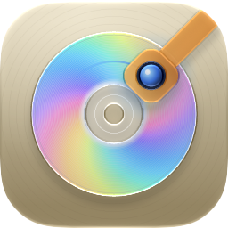

# Silverside

Welcome to Silverside!



Silverside is a CD ripping app for macOS intended to produce secure,
verified rips of audio CDs, inspired by Exact Audio Copy (EAC) for
Windows but with a modern Mac interface. It extracts the audio from CDs into
a folder of your choice in a highly accurate manner with an extraction
report, and can optionally encode the tracks into your preferred format
such as FLAC, Apple Lossless, AAC, WAV, or (with a helper app) MP3, as well
as tag the tracks with accurate metadata (song titles, composers, and so on).

My goal for Silverside is to be the best CD ripping app you can get, whether
free or paid.

## Key features 

- Easy to use Mac app and a command-line tool `silverside` that share one engine 
  and settings file.
- Advanced CD audio extraction and verification
- 20-bit HDCD decoding when applicable for enhanced dynamic range.
- ReplayGain tags for consistent playback volume
- Excellent handling of multi-CD sets and online metadata lookup (track titles, etc.)

See also:

- [silverside.app](https://silverside.app) official site
- [CHANGELOG.md](CHANGELOG.md) changes in each version.
- [LICENSE](LICENSE)

## Requirements

It requires an Apple Silicon or Intel Mac, running macOS 15 (Sequoia)
or later, and a CD drive (or a compatible CD/DVD/BD drive), and of
course some audio CDs that you want to rip.

Any drive that macOS sees as a CD drive works, however it is connected.
No Mac that runs macOS 15 came with a built-in optical drive, so in
practice the drive is external: USB (tested with four drives),
Thunderbolt, or a SATA drive in an enclosure.

Encoding to MP3 requires an [external CLI encoder app](#encoding-to-mp3)
to be installed. All other supported formats are handled natively.

### Why it is not in the Mac App Store

Apps in the Mac App Store must run in Apple's App Sandbox, which does not
allow the low-level access to the drive that accurate ripping needs: reading
raw audio sectors, the C2 error flags, the subchannel, and the full table of
contents. So Silverside is distributed from [silverside.app](https://silverside.app)
instead. Release builds are signed with a Developer ID and notarized by
Apple, so macOS opens them without warnings.

## Silverside features

- **Accurate rips.** Each track is read with the drive's read offset corrected,
  and checked against [AccurateRip](http://www.accuraterip.com) and the
  [CUETools database](http://cue.tools/wiki/CUETools_Database) (CTDB), which
  hold checksums from other people's rips of the same disc.
- **Secure re-reads.** A track that does not match is read again. Sectors that
  read differently, that the drive flags with C2 errors, or that cannot be
  read at all are re-read until their data matches or the re-reads give up.
- **Repair.** A disc with errors is repaired with CTDB's repair data, and the
  repaired tracks are checked against AccurateRip again.
- **Check Again.** A new release is often in neither database at first. Check
  Again looks an earlier rip up again weeks later, and checks it from its
  files, without the disc.
- **Metadata from [MusicBrainz](https://musicbrainz.org)**, and cover art from
  the [Cover Art Archive](https://coverartarchive.org): front covers, and
  back covers and booklets if you want them. The tags carry the composers,
  lyricists, genre, and sort names that MusicBrainz has. You can choose
  another of the archive's images, or your own, before or after the rip, and
  the discs of a box set can each take their own sleeve.
- **Encoding** to FLAC, Apple Lossless (ALAC), AAC, AIFF, WAV, or MP3, with
  tags and the cover embedded. Each file is checked after encoding: a
  lossless file must decode to exactly the ripped audio. Optionally, the
  files go into the Music app (every format but FLAC).
- **ReplayGain tags**, measured as EBU R 128 does, so players that read them
  play albums at one volume level. The raw audio samples are not changed.
- **Multi-disc sets.** The discs of a release share the release choice, the
  album's names, the cover, one album folder, and one album gain. A set has
  a view of its own: each disc's state, the work left, and buttons that
  encode the discs not in the library yet and bring the encoded ones up to
  date with the set's names and cover.
- **HDCD.** Each track is checked for HDCD codes, and the app shows the HDCD
  logo with what they ask for. Most discs with the logo have codes that ask
  for nothing, so a decoder would play the same audio. A disc whose codes ask
  for peak extend or gain can be decoded, at the rip or later, into 20-bit
  FLAC or Apple Lossless files that keep what the decoder restores, or into
  AAC or MP3 before a lossy encode removes the codes.
- **Pre-emphasis.** A few early CDs were mastered with pre-emphasis, a treble
  boost that a CD player takes out again. Silverside finds the flag in the table
  of contents and in the subchannel (some discs set it in only one) and, if you
  agree, takes it out as a CD player does, into 20-bit FLAC or Apple Lossless
  files tagged `DE_EMPHASIZED=yes`. Kept as pressed, the files are tagged
  `PRE_EMPHASIS=yes`, and the CUE sheet marks the tracks (`FLAGS PRE`).
- **Disc images**, if you want them: the whole disc in one lossless file with
  a CUE sheet, beside the library, from which the disc can be burned again.
- **A rip report**, as Markdown to read and as JSON (`disc.json`), with every
  track's result, its CRC-32 as EAC and XLD print it, the TOC, pregaps and
  index points, the
  disc IDs, the ISRCs, MCN, and CD-Text, the media (pressed CD or CD-R), the
  drive and its offset, the release, and the encoding; and a **CUE sheet**,
  with the pregaps and the index points after 01, from which the disc can be
  burned again exactly.
- **Hidden track one audio** (a song before track 1) is ripped and encoded as
  track 0.
- **Enhanced CDs:** the data track after the music is kept as a disc image
  (`Data track.iso`, both its Windows and its classic Mac file systems), with
  the Windows side's files copied into a `Data track` folder, ready to open.
- **Names you can change.** The album's title, artist, and date, and each
  track's title and artist, can be edited in the app or with
  `silverside metadata --set`, and the files are named and tagged with the edits.
  After the rip too: the encoded files are tagged and renamed again, and the
  audio is not touched. The album's edits are kept for the release, so the
  other discs of a set get them. The disc's CD-Text names (in your language,
  if the disc has it) can replace MusicBrainz's. A disc that MusicBrainz does
  not know gets its names from CD-Text or from you, and its files carry no
  MusicBrainz IDs.
- **Play a track** from the disc, read as a rip reads it, or from an earlier
  rip, to check it.
- **Rip on insertion**, if you want it: a disc whose release is certain, and
  that is not ripped yet, rips a few seconds after it goes in.

### Known limits


## Ripping marginal CDs

Note that it will take longer to rip a marginal CD than a nice
defect-free CD (no major scratches, gouges, disc rot, etc).

Using a different drive might help.

Tips:

- **Clean the disc first.** Light cleaning helped several discs in testing.
- **Let the rip finish.** A damaged track can take several minutes: the
  status line shows each read, the sectors with C2 errors, and the rounds of
  re-reads. Most damaged discs that were tested came out fully accurate from
  one rip, after the CTDB repair.
- **Stop cleanly.** Stop in the app (or Ctrl-C in the command-line tool)
  lets the read under way finish, the tracks done so far stay in the rip's
  folder, and a second rip of the disc takes the folder over.
- **Try another drive.** Drives differ in how many versions of a damaged
  sector they return, and more versions help the repair. A disc that one
  drive could not finish was repaired from one rip in another.
- **Pool rips from several drives.** Rip the disc again in a second drive:
  the app pools the earlier rips of the disc by default (`--pool` in the
  command-line tool). An accurate track from either rip is used, and the
  other versions join the repair.
- **Keep the rip.** Each rip keeps its suspect samples next to its WAV files,
  so Repair (in the app, or `silverside repair`) can try again later, with
  more rips or more re-reads.
- **Some discs cannot be repaired.** When too much of a disc is damaged (a
  scratch across many tracks, or damage to the reflective layer), the tracks
  that verify are still marked as verified, and the others are not.

## Encoding to MP3

Apple's audio frameworks cannot write MP3, so Silverside uses the free
[LAME](https://lame.sourceforge.io) encoder for it. Install it with
[Homebrew](https://brew.sh):

```sh
brew install lame
```

Silverside finds `lame` on your `PATH` (or in `/opt/homebrew/bin` or
`/usr/local/bin`), sends it the audio, and writes the tags itself. The
environment variable `SILVERSIDE_LAME` can name another `lame`, or with
`none` make Silverside act as if it were not installed. By default
it uses LAME's best variable bit rate (`-V 0`, about 245 kbit/s); Settings ›
Encoding changes that.

## MusicBrainz

Silverside looks up each disc in MusicBrainz once, waits between requests, and
keeps the answers in a cache, as MusicBrainz asks of programs that use it. When
MusicBrainz does not know a disc's ID, Silverside finds the release by its
track lengths, and links to the page that adds the disc ID to MusicBrainz.
When several releases have the disc (such as a show and a box set that holds
it), Silverside asks which one, and remembers the answer for the other discs.

A disc that MusicBrainz does not know at all is named from its CD-Text or by
you, and its files get no MusicBrainz IDs. Adding the release to MusicBrainz,
then looking up the disc again, is better for everyone.

## Building from source

With Xcode installed, from a copy of this repository:

```sh
make install-app          # the Mac app, for Apple silicon and Intel, in ~/Applications
make install-cli-local    # the silverside command-line tool, in ~/.local/bin
make test                 # the engine's tests
```

Open `Silverside.xcworkspace` in Xcode to work on the app, the engine, and the
command-line tool together. At its first launch, the app asks what a rip
should become (Apple Lossless, FLAC, AAC, MP3, or WAV files only).

## The command-line tool

`silverside` does everything the app does, from a terminal, with the same
settings file. See [docs/cli.md](docs/cli.md) for its commands, what a rip
makes, and the settings.

## How the audio processing was checked

[ReplayGain](docs/ReplayGain.md), [HDCD](docs/HDCD.md), and
[pre-emphasis](docs/PreEmphasis.md) each have a short page: what Silverside
does, and how it was compared with independent tools and real discs.

## Roadmap

### Planned for 1.0

- **Search MusicBrainz by album or artist**, for a disc whose TOC it does not
  know (a burned disc, or a pressing it has not seen), and tag the disc from
  the release you choose.
- **Whole-disc images in the CloneCD format** (`.ccd`, `.img`, `.sub`), for
  archiving: every session of a multisession disc such as an Enhanced CD,
  with the full subchannel, which also keeps CD-Text and CD+G graphics.
- **Mixed-mode discs** (a data track first, then music), checked on real
  discs, and CUE sheets that describe the whole disc.
- **Copy-controlled discs:** checked on real discs, with a note in the report
  when a disc looks copy-controlled.
- More tests with real discs: CD+G, hidden track one audio.
- Signed and notarized release builds, with Add to Music working under
  macOS's hardened runtime.
- Polish in the app.

### Possible later (2.0 or beyond, no date)

- Submit to MusicBrainz straight from the app. Today Silverside opens
  MusicBrainz's release editor filled in from the disc, to check and submit
  there.
- Submit rips to CTDB, also later from a saved rip.
- CD burning, with verification.
- CD+G graphics as a `.cdg` file beside the audio.
- A slower drive speed, for quieter rips, and slowing down by itself on a
  troubled disc.
- A C2 error-flag check for each drive, kept in its profile.
- A warning before a lossy encode of a DTS-CD; 
- DVD-Audio extraction support.
- An option to leave out silent filler tracks (as before a hidden track at the
  end).
- A second metadata source (GnuDB), and AcoustID.
- Several encodings at once (for example FLAC and AAC).
- More filename template options, and per-track pregap adjustments.
- The app in other languages.

See [docs/internal/Milestones.md](docs/internal/Milestones.md) for the plan.

## License

The code is under the MIT License; see [LICENSE](LICENSE). The name "Silverside"
and the icon and logo artwork are not covered by it: a modified version that
you distribute needs a different name and icon.
