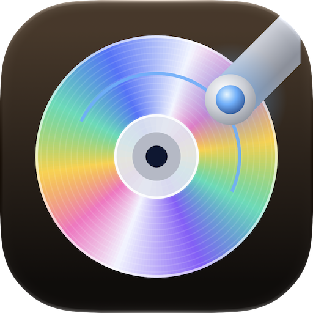

# Silverside

Welcome to Silverside!



Silverside is a CD ripping app for macOS intended to produce secure,
verified rips of audio CDs, inspired by Exact Audio Copy (EAC) for
Windows but with a modern Mac interface. It extracts the audio from CDs into
a folder of your choice in a highly accurate manner with an extraction
report, and can optionally encode the tracks into your preferred format
such as FLAC, Apple Lossless, AAC, WAV, or (with a helper app) MP3, as well
as tag the tracks with appropriate metadata (song and album titles).

Website: [silverside.app](https://silverside.app).

It is a Mac app, Silverside, and a command-line tool, `silverside`, which share
one engine and one settings file. [CHANGELOG.md](CHANGELOG.md) says what
changed in each version.

## Requirements

It requires an Apple Silicon or Intel Mac, running macOS 15 (Sequoia)
or later, and a CD drive (or a compatible CD/DVD/BD drive), and of
course some audio CDs that you want to rip.

Any drive that macOS sees as a CD drive works, however it is connected.
No Mac that runs macOS 15 came with a built-in optical drive, so in
practice the drive is external: USB (tested with four drives),
Thunderbolt, or a SATA drive in an enclosure.

Encoding to MP3 requires an [external CLI encoder app](#encoding-to-mp3)
to be installed. All other supported formats are handled natively.

## Features

- **Accurate rips.** Each track is read with the drive's read offset corrected,
  and checked against [AccurateRip](http://www.accuraterip.com) and the
  [CUETools database](http://cue.tools/wiki/CUETools_Database) (CTDB), which
  hold checksums from other people's rips of the same disc.
- **Secure re-reads.** A track that does not match is read again. Sectors that
  read differently, that the drive flags with C2 errors, or that cannot be
  read at all are re-read until their data matches or the re-reads give up.
- **Repair.** A disc with errors is repaired with CTDB's repair data, and the
  repaired tracks are checked against AccurateRip again.
- **Metadata from [MusicBrainz](https://musicbrainz.org)**, and cover art from
  the [Cover Art Archive](https://coverartarchive.org): front covers, and
  back covers and booklets if you want them.
- **Encoding** to FLAC, Apple Lossless (ALAC), AAC, AIFF, WAV, or MP3, with
  tags and the cover embedded. Each file is checked after encoding: a
  lossless file must decode to exactly the ripped audio.
- **A rip report**, as Markdown to read and as JSON (`disc.json`), with every
  track's result, the TOC, pregaps, the disc IDs, the ISRCs, MCN, and CD-Text,
  the drive and its offset, and the release; and a **CUE sheet**, from which
  the disc can be burned again exactly.
- **Hidden track one audio** (a song before track 1) is ripped and encoded as
  track 0.
- **Names you can change.** The album's title, artist, and date, and each
  track's title and artist, can be edited in the app or with
  `silverside metadata --set`, and the files are named and tagged with the edits.
  The album's edits are kept for the release, so the other discs of a set get
  them. A disc that MusicBrainz does not know gets its names from CD-Text or
  from you, and its files carry no MusicBrainz IDs.

## Known limits

- **Pre-emphasis.** A few early CDs were mastered with pre-emphasis, a treble
  boost that the player undoes. Silverside marks such tracks in the rip report and
  the CUE sheet (`FLAGS PRE`), and warns when it encodes them, but it does not
  change the audio: the files sound too bright in a player that does not read
  the flag. De-emphasis is planned. This is not yet confirmed on a real
  pre-emphasis disc, because none has turned up in testing.

AccurateRip and CTDB answer over plain HTTP, as their other clients use them.
Their checksums are public, so there is nothing to keep secret, but a network
that forged their answers could make a bad rip look verified. MusicBrainz and
the Cover Art Archive are reached over HTTPS.

## Ripping marginal CDs

Note that it will take longer to rip a marginal CD than a nice
defect-free CD (no major scratches, gouges, disc rot, etc).

Using a different drive might help.

Tips:

- **Clean the disc first.** Light cleaning helped several discs in testing.
- **Let the rip finish.** A damaged track can take several minutes: the
  status line shows each read, the sectors with C2 errors, and the rounds of
  re-reads. Most damaged discs that were tested came out fully accurate from
  one rip, after the CTDB repair.
- **Stop cleanly.** Stop in the app (or Ctrl-C in the command-line tool)
  lets the read under way finish, the tracks done so far stay in the rip's
  folder, and a second rip of the disc takes the folder over.
- **Try another drive.** Drives differ in how many versions of a damaged
  sector they return, and more versions help the repair. A disc that one
  drive could not finish was repaired from one rip in another.
- **Pool rips from several drives.** Rip the disc again in a second drive:
  the app pools the earlier rips of the disc by default (`--pool` in the
  command-line tool). An accurate track from either rip is used, and the
  other versions join the repair.
- **Keep the rip.** Each rip keeps its suspect samples next to its WAV files,
  so Repair (in the app, or `silverside repair`) can try again later, with
  more rips or more re-reads.
- **Some discs cannot be repaired.** When too much of a disc is damaged (a
  scratch across many tracks, or damage to the reflective layer), the tracks
  that verify are still marked as verified, and the others are not.

## Encoding to MP3

Apple's audio frameworks cannot write MP3, so Silverside uses the free
[LAME](https://lame.sourceforge.io) encoder for it. Install it with
[Homebrew](https://brew.sh):

```sh
brew install lame
```

Silverside finds `lame` on your `PATH` (or in `/opt/homebrew/bin` or
`/usr/local/bin`), sends it the audio, and writes the tags itself. The
environment variable `SILVERSIDE_LAME` can name another `lame`, or with
`none` make Silverside act as if it were not installed. By default
it uses LAME's best variable bit rate (`-V 0`, about 245 kbit/s); Settings ›
Encoding changes that.

## MusicBrainz

Silverside looks up each disc in MusicBrainz once, waits between requests, and
keeps the answers in a cache, as MusicBrainz asks of programs that use it. When
MusicBrainz does not know a disc's ID, Silverside finds the release by its
track lengths, and links to the page that adds the disc ID to MusicBrainz.
When several releases have the disc (such as a show and a box set that holds
it), Silverside asks which one, and remembers the answer for the other discs.

A disc that MusicBrainz does not know at all is named from its CD-Text or by
you, and its files get no MusicBrainz IDs. Adding the release to MusicBrainz,
then looking up the disc again, is better for everyone.

## Building from source

With Xcode installed, from a copy of this repository:

```sh
make install-app          # the Mac app, for Apple silicon and Intel, in ~/Applications
make install-cli-local    # the silverside command-line tool, in ~/.local/bin
make test                 # the engine's tests
```

Open `Silverside.xcworkspace` in Xcode to work on the app, the engine, and the
command-line tool together. At its first launch, the app asks what a rip
should become (Apple Lossless, FLAC, AAC, MP3, or WAV files only).

## The command-line tool

`silverside` does everything the app does, from a terminal, with the same
settings file. See [docs/cli.md](docs/cli.md) for its commands, what a rip
makes, and the settings.

## TODO or future ideas

- **Multi-disc sets.** The discs of a release share the release choice and
  the album's edits, and the app says which discs of a set are ripped. Still
  to do: reusable style recipes for titles.
- Pre-emphasis support as mentioned above.
- Option for automatic rip on insertion and recognition
- Localization in other languages. 
- Recognition of HDCD; possible 24-bit decode.
- ReplayGain tags.
- Ripping of data tracks for mixed-mode / Enhanced CDs.
- Option to slow down drive speed (quieter)
  - Autodetect and engage this during problem rips
- Multiple encodings at once (e.g. FLAC + AAC)
- AcoustID?
- Rip log checksum
- Per-track pregap adjustments
- Option to import rips to Apple Music if compatible
- CD Burning with verification
- Filename template enhancements
- Search MusicBrainz by album or artist, for a disc whose TOC it does not know (a
  burned disc, or a pressing it has not seen), and tag the disc from the chosen
  release
- Secondary metadata source (GnuDB)
- Ability to add image art after encoding

See [docs/internal/Milestones.md](docs/internal/Milestones.md) for the plan.

## License

The code is under the MIT License; see [LICENSE](LICENSE). The name "Silverside"
and the icon and logo artwork are not covered by it: a modified version that
you distribute needs a different name and icon.
